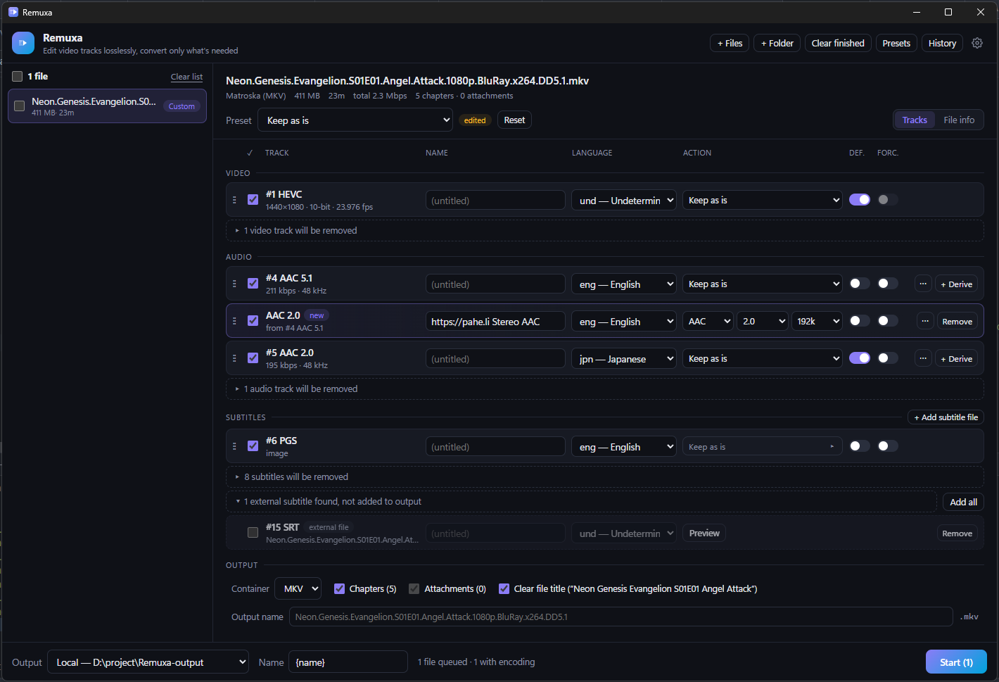

<p align="center"></p>

<h1 align="center">Remuxa</h1>

<p align="center">
Video parçalarını kayıpsız düzenle, yalnızca gerekeni dönüştür.<br>
<i>Edit video tracks losslessly, convert only what's needed.</i>
</p>

<p align="center"><a href="#english">English below</a></p>

<p align="center"></p>

---

## Türkçe

Remuxa, video dosyalarının parçalarını (video, ses, altyazı, ek, bölüm) düzenleyen bir Windows masaüstü uygulamasıdır.
Varsayılan iş **remux**'tur, yani kalite kaybı olmaz. Yalnızca sen seçtiğin parça yeniden kodlanır.

### Neler yapar

- **Parça editörü:** Her parçayı tut, çıkar ya da sürükleyerek sırala. Ad, dil, varsayılan ve zorunlu bayraklarını ayarla.
- **Ses:** AAC, AC3, E-AC3, Opus, FLAC ya da MP3'e çevirir. Uyumsuz sese stereo kopya ekler.
  Ses seviyesini eşitler (EBU R128), 5.1'den stereoya inerken diyaloğu öne çıkarır, gecikmeyi düzeltir.
  Sesi ayrı dosya olarak dışa aktarabilirsin.
- **Video:** H.264, HEVC ya da AV1'e çevirir. Ekran kartı otomatik algılanır (NVIDIA NVENC, Intel QSV, AMD AMF); yoksa işlemci kullanılır.
  Çözünürlük düşürme, HDR → SDR, 10-bit → 8-bit ve altyazıyı görüntüye yakma da var.
  30 saniyelik deneme kodlamasıyla hızı ve tahmini boyutu önceden görürsün.
- **Altyazı:** Videonun yanındaki `.srt/.ass/.vtt/.sup/.idx` dosyalarını bulur. UTF-8 olmayanları çevirir, bozuk Türkçe karakterleri düzeltir.
  Zaman kaydırma, ASS → SRT, önizleme ve dışa aktarma da var.
- **Toplu iş:** Bir dizi klasörünü bırak, hazır ayar uygula ya da bir dosyanın düzenini aynı yapıdaki diğerlerine kopyala.
- **Hazır ayarlar:** Medya sunucusu uyumlu ses, eski cihazlar için H.264, arşiv için HEVC, gece izleme ve daha fazlası. Kendi ayarlarını da oluşturabilirsin.
- **Güvenli yazma:** Her çıktı doğrulanır. Yerel klasöre, NAS'a ya da dosyanın kendi yerine yazar; yarım dosya bırakmaz.
- **Kuyruk:** Liste kapatınca kaybolmaz. "Bitince dur", Windows bildirimi, her iş için log ve geçmiş ekranı var.
- Türkçe ve İngilizce arayüz.

### Kurulum

1. [Releases](../../releases) sayfasından `Remuxa_x.y.z_x64-setup.exe` dosyasını indirip çalıştır.
2. ffmpeg ve MKVToolNix yüklü değilse uygulama ilk açılışta **Otomatik kur** düğmesi gösterir (winget kullanır). Elle kurmak istersen:

```cmd
winget install Gyan.FFmpeg
winget install MoritzBunkus.MKVToolNix
```

### Geliştirme

Gereksinimler: Node.js 20+, Rust (stable), Windows'ta WebView2 (Windows 10/11'de hazır gelir).

```cmd
npm install
npm run tauri dev
```

Kurulum dosyası: `npm run tauri build` (çıktı: `src-tauri/target/release/bundle/nsis/`).
Sürüm yayınlamak için etiket at (`git tag v0.9.0 && git push --tags`); GitHub Actions kurulum dosyasını derleyip taslak bir release açar.

---

## English

Remuxa is a Windows desktop app for editing the tracks of video files (video, audio, subtitles, attachments, chapters).
The default operation is a lossless **remux**; only the tracks you choose are re-encoded.

### Features

- **Track editor:** keep, remove or drag to reorder any track; set name, language, default and forced flags.
- **Audio:** convert to AAC, AC3, E-AC3, Opus, FLAC or MP3, or add a stereo copy for incompatible audio.
  Includes loudness normalization (EBU R128), dialogue-boosted 5.1 → stereo downmix, delay correction and lossless audio export.
- **Video:** convert to H.264, HEVC or AV1 with automatic GPU detection (NVIDIA NVENC, Intel QSV, AMD AMF), falling back to the CPU.
  Also supports downscaling, HDR → SDR tone mapping, 10-bit → 8-bit and burning in subtitles.
  A 30-second test encode shows the speed and estimated size first.
- **Subtitles:** picks up `.srt/.ass/.vtt/.sup/.idx` files next to the video, converts non-UTF-8 encodings and fixes broken Turkish characters.
  Also supports timing shift, ASS → SRT, preview and export.
- **Batch:** drop a whole series folder, apply a preset or copy one file's layout to files with the same structure.
- **Presets:** media-server friendly audio, H.264 for older devices, HEVC for archiving, night mode and more. You can also make your own.
- **Safe output:** every result is verified. Write to a local folder, a NAS or in place, with no half-written files.
- **Queue:** persists across restarts, with stop-after-current, Windows notifications, per-job logs and a history view.
- Turkish and English UI.

### Install

1. Download and run `Remuxa_x.y.z_x64-setup.exe` from [Releases](../../releases).
2. If ffmpeg and MKVToolNix are missing, the app offers **Install automatically** (via winget) on first start. To install them manually:

```cmd
winget install Gyan.FFmpeg
winget install MoritzBunkus.MKVToolNix
```

### Development

Requirements: Node.js 20+, Rust (stable), WebView2 on Windows (included with Windows 10/11).

```cmd
npm install
npm run tauri dev
```

To build the installer, run `npm run tauri build` (output: `src-tauri/target/release/bundle/nsis/`).
To publish a release, push a tag (`git tag v0.9.0 && git push --tags`); GitHub Actions builds the installer and creates a draft release.

## License

Copyright © 2026 YasoDigo

[GPL-3.0-or-later](LICENSE). Remuxa calls [ffmpeg](https://ffmpeg.org) and [MKVToolNix](https://mkvtoolnix.download) as separate programs.
